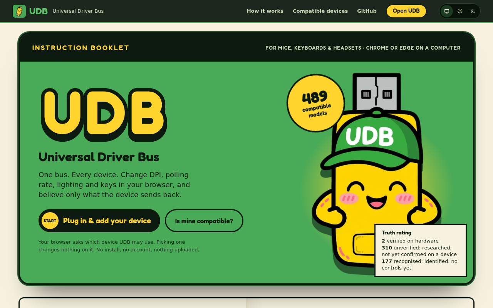

# UDB · Universal Driver Bus

**One bus. Every device.** Mouse, keyboard and headset settings in your
browser, showing only what the device sends back.

**Open it: <https://udb.lorenzmalabanan.com>**



UDB talks to gaming mice, keyboards and headsets over WebHID, straight from a
browser tab. There is nothing to install and no account, and nothing leaves
your computer. It replaces the vendor apps for the settings it knows, and it
says plainly which settings those are.

## Features

- **Read, change, read back.** UDB reads a setting from the device, writes your
  change once when you let go of the control, then reads it back. The screen
  shows the device's answer, never your request. If the device disagrees, UDB
  restores the previous value and says so.
- **DPI stages, polling rate, debounce, lift-off, lighting and keys** where a
  device's protocol is known (Pulsar/ATK/VXE, Mechlands Vibe75, QMK/VIA,
  Logitech HID++, Razer, Corsair, Windows Dynamic Lighting). See
  [SUPPORT.md](SUPPORT.md) for each model.
- **Profiles** kept in this browser: save a mouse or keyboard setup, export and
  import it as a file, and apply it to any compatible device.
- **VIA keymaps** (experimental): load a keyboard's VIA definition and change
  one key at a time.
- **Diagnostics and device reports** that hold descriptor details only, so you
  can ask for your device to be supported.
- **Works offline** once loaded, and installs as an app.

## The truth rules

UDB's whole point is that the screen tells the truth about your device.

- Only `write-verified`, backed by recorded evidence from real hardware, means a
  setting is known to work. A simulator or replay result never counts.
- Every write is read back, and UDB reports what the device actually returned.
- Settings researched but not yet confirmed on a device are labelled
  **unverified**, and writes to them stay off until you allow them per device.
- UDB never sends firmware, bootloader, DFU, pairing or factory-reset commands.

Only a few models are verified on hardware so far; hundreds more are
researched or recognised. The landing page's truth rating shows the current
counts.

## Browsers and devices

- **Chrome or Edge** on Windows, macOS or Linux. Firefox, Safari and phones
  don't have WebHID.
- A secure page: the hosted site, or `localhost` when you run it yourself.
- Close the vendor app (Synapse, G HUB, iCUE and the like) first; it can hold
  the device.
- The per-model support matrix is [SUPPORT.md](SUPPORT.md), generated from
  [`registry/`](registry/). What UDB does and doesn't do: [SPEC.md](SPEC.md).

## Privacy

UDB collects nothing: no telemetry, no analytics, no account, no requests to
any other site (a strict Content Security Policy enforces `connect-src
'self'`). Profiles, your theme and onboarding state stay in this browser's
storage. Device reports and evidence reach your clipboard only when you ask.
The site is served by GitHub Pages, which may log requests like any host.

## Quick start

Node 24 or newer.

```bash
npm ci
npm run dev
```

Open the printed `localhost` URL in Chrome or Edge. `/?preview` loads fake
devices backed by protocol simulators, for design work without hardware.

| Script | What it does |
|---|---|
| `npm run dev` | Dev server with hot reload |
| `npm run build` | Production build into `dist/`: the client bundle, the prerendered public pages, and the service worker |
| `npm run preview` | Serve `dist/` locally |
| `npm run check` | Type and Svelte checks, warnings fail |
| `npm test` | Unit, protocol, simulator and prerender tests (Vitest) |
| `npm run support` | Regenerate `SUPPORT.md` from the registry |
| `npm run import:*` | Re-import vendor catalogues and product images (maintainers) |

## Project layout

```
src/
  App.svelte        routes: public pages on paths, the app behind #/ hashes
  prerender.ts      the public pages' heads, rendered at build time
  ui/               Svelte components (device view, panels, landing, controls)
  lib/              device store, registry, write-and-read-back, profiles
  adapters/         one protocol per folder of commands, each with an allowlist
  dev/              the /?preview fake devices (dev only)
registry/           one JSON file per device model, plus its schema
public/             icons, fonts, brand art, product images, robots and sitemap
scripts/            build helpers (prerender, service worker) and importers
tests/              Vitest suites, protocol simulators and captured fixtures
docs/               ADRs, protocol notes, deployment, design notes
```

## Deployment

Every merge to `main` is built by GitHub Actions and deployed to GitHub Pages
at <https://udb.lorenzmalabanan.com>. DNS, HTTPS, domain verification and the
release checklist are in [docs/deploy.md](docs/deploy.md).

## Contributing

New devices, protocol research and hardware verification are welcome. Start
with [CONTRIBUTING.md](CONTRIBUTING.md); test and evidence rules are in
[TESTING.md](TESTING.md). Decisions are recorded in [docs/adr/](docs/adr/) and
the plan in [ROADMAP.md](ROADMAP.md).

## Security

Please don't open a public issue for a security problem. Use **Report a
vulnerability** on the repository's
[Security tab](https://github.com/E1yWrites/udb/security). The threat model is
[THREAT_MODEL.md](THREAT_MODEL.md).

## Licence

UDB is free software under the GNU General Public License, version 3 or later
([LICENSE](LICENSE)). Some protocol code is ported from AGPL-3.0 projects, so
the hosted app as a whole is offered under AGPL-3.0 terms, and every page links
to the exact source of its build ([ADR 8](docs/adr/0008-agpl-ported-code.md)).
The Fredoka font is under the SIL Open Font License (`third_party/fredoka/`).

Product names, trademarks and the product images in `public/devices/` belong to
their makers and aren't covered by UDB's licence; their sources are listed in
`registry/images.json` ([ADR 10](docs/adr/0010-vendor-product-images.md)). UDB
isn't affiliated with any device maker.
