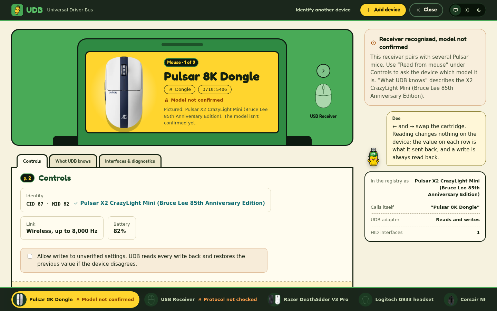
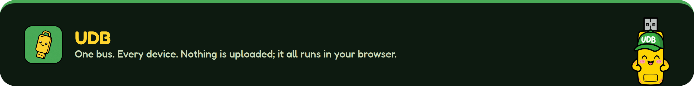

<div align="center">

<a href="https://udb.lorenzmalabanan.com"></a>

<p>
  <a href="https://udb.lorenzmalabanan.com"></a>
</p>

<p>
  <a href="https://github.com/E1yWrites/udb/actions/workflows/ci.yml"></a>
  <a href="LICENSE"></a>
  <a href="docs/adr/0008-agpl-ported-code.md"></a>
  <a href="https://wicg.github.io/webhid/"></a>
  <a href="#privacy"></a>
</p>

<p>
  <a href="https://svelte.dev"></a>
  <a href="https://www.typescriptlang.org"></a>
  <a href="https://vite.dev"></a>
  <a href="https://vitest.dev"></a>
  <a href="https://nodejs.org"></a>
  <a href="https://developer.mozilla.org/docs/Web/HTML"></a>
  <a href="https://developer.mozilla.org/docs/Web/CSS"></a>
  <a href="https://docs.github.com/actions"></a>
  <a href="https://pages.github.com"></a>
</p>

**[Open UDB](https://udb.lorenzmalabanan.com)** ·
[Supported devices](SUPPORT.md) ·
[How it works](#how-it-works) ·
[Quick start](#quick-start) ·
[Contributing](CONTRIBUTING.md) ·
[Credits](#credits)

</div>

---

UDB talks to gaming mice, keyboards and headsets over WebHID, straight from a
browser tab. There is nothing to install and no account, and nothing leaves
your computer. It replaces the vendor apps for the settings it knows, and it
says plainly which settings those are.

<table>
  <tr>
    <td width="50%"></td>
    <td width="50%"></td>
  </tr>
  <tr>
    <td align="center"><sub>The cover. START is the real browser request for a device.</sub></td>
    <td align="center"><sub>The device view, in the design preview with simulated devices.</sub></td>
  </tr>
</table>

## How it works

| | |
|---|---|
| **1 · Read** | UDB asks the device for its settings. Nothing changes on it. |
| **2 · Change** | Slide or pick a value. It's written once, when you let go. |
| **3 · Read back** | The device's own answer replaces your request on screen. If it disagrees, UDB puts the old value back and says so. |

## Features

- **DPI stages, polling rate, debounce, lift-off, lighting and keys** where a
  device's protocol is known: Pulsar/ATK, Mechlands Vibe75, QMK/VIA, Logitech
  HID++, Razer, Corsair and Windows Dynamic Lighting. [SUPPORT.md](SUPPORT.md)
  lists every model.
- **Profiles** kept in this browser: save a mouse or keyboard setup, export and
  import it as a file, and apply it to any compatible device.
- **VIA keymaps** (experimental): load a keyboard's VIA definition and change
  one key at a time.
- **Diagnostics and device reports** that hold descriptor details only, so you
  can ask for your device to be supported.
- **Works offline** once loaded, and installs as an app.
- **Dee**, the mascot, guides you through the first device and every recovery.

## The truth rules

> [!IMPORTANT]
> UDB's whole point is that the screen tells the truth about your device.

- Only `write-verified`, backed by recorded evidence from real hardware, means a
  setting is known to work. A simulator or replay result never counts.
- Every write is read back, and UDB reports what the device actually returned.
- Settings researched but not yet confirmed on a device are labelled
  **unverified**, and writes to them stay off until you allow them per device.
- UDB never sends firmware, bootloader, DFU, pairing or factory-reset commands.

Only a few models are verified on hardware so far; hundreds more are
researched or recognised. The landing page's truth rating shows the current
counts.

## Browsers and devices

| Needs | Why |
|---|---|
| **Chrome or Edge** on Windows, macOS or Linux | Firefox, Safari and phones don't have WebHID. |
| **A secure page** | The hosted site, or `localhost` when you run it yourself. |
| **The vendor app closed** | Synapse, G HUB, iCUE and the like can hold the device. |

The per-model support matrix is [SUPPORT.md](SUPPORT.md), generated from
[`registry/`](registry/). What UDB does and doesn't do: [SPEC.md](SPEC.md).

## Privacy

UDB collects nothing: no telemetry, no analytics, no account, and no requests
to any other site (a strict Content Security Policy enforces `connect-src
'self'`). Profiles, your theme and onboarding state stay in this browser's
storage. Device reports and evidence reach your clipboard only when you ask.
The site is served by GitHub Pages, which may log requests like any host.

## Quick start

Node 24 or newer.

```bash
npm ci
npm run dev
```

Open the printed `localhost` URL in Chrome or Edge. `/?preview` loads fake
devices backed by protocol simulators, for design work without hardware.

| Script | What it does |
|---|---|
| `npm run dev` | Dev server with hot reload |
| `npm run build` | Production build into `dist/`: the client bundle, the prerendered public pages, and the service worker |
| `npm run preview` | Serve `dist/` locally |
| `npm run check` | Type and Svelte checks, warnings fail |
| `npm test` | Unit, protocol, simulator and prerender tests (Vitest) |
| `npm run support` | Regenerate `SUPPORT.md` from the registry |
| `npm run import:*` | Re-import vendor catalogues and product images (maintainers) |

<details>
<summary><strong>Project layout</strong></summary>

```
src/
  App.svelte        routes: public pages on paths, the app behind #/ hashes
  prerender.ts      the public pages' heads, rendered at build time
  ui/               Svelte components (device view, panels, landing, controls)
  lib/              device store, registry, write-and-read-back, profiles
  adapters/         one protocol per folder of commands, each with an allowlist
  dev/              the /?preview fake devices (dev only)
registry/           one JSON file per device model, plus its schema
public/             icons, fonts, brand art, product images, robots and sitemap
scripts/            build helpers (prerender, service worker) and importers
tests/              Vitest suites, protocol simulators and captured fixtures
docs/               ADRs, protocol notes, deployment, design notes
third_party/        vendored data and code, each with its licence
```

</details>

## Deployment

Every merge to `main` is built by GitHub Actions and deployed to GitHub Pages
at <https://udb.lorenzmalabanan.com>. DNS, HTTPS, domain verification and the
release checklist are in [docs/deploy.md](docs/deploy.md).

## Contributing

New devices, protocol research and hardware verification are welcome. Start
with [CONTRIBUTING.md](CONTRIBUTING.md); test and evidence rules are in
[TESTING.md](TESTING.md). Decisions are recorded in [docs/adr/](docs/adr/) and
the plan in [ROADMAP.md](ROADMAP.md).

## Security

Please don't open a public issue for a security problem. Use **Report a
vulnerability** on the repository's
[Security tab](https://github.com/E1yWrites/udb/security). The threat model is
[THREAT_MODEL.md](THREAT_MODEL.md).

## Credits

UDB stands on other people's research. Every protocol note in
[`docs/protocols/`](docs/protocols/) lists its exact sources, commits and
licences; here they are by name.

### Protocol research and code

| Project | What UDB took from it | Licence |
|---|---|---|
| [OpenMouse](https://github.com/OpenMouse-Project/openmouse) and [mouse-protocol](https://github.com/OpenMouse-Project/mouse-protocol) | Ported protocols for ATK/VXE, Logitech, Razer, Corsair, Glorious, SteelSeries and Wooting; device catalogues; captures | AGPL-3.0 |
| [OpenRazer](https://github.com/openrazer/openrazer) | The Razer protocol, as audited by OpenMouse | GPL-2.0-or-later |
| [libratbag](https://github.com/libratbag/libratbag) | Logitech and Roccat device data and the Roccat protocol | MIT |
| [HeadsetControl](https://github.com/Sapd/HeadsetControl) | Logitech and HyperX headset IDs and their protocols | GPL-3.0 |
| [QMK](https://github.com/qmk/qmk_firmware) and the [VIA app](https://github.com/the-via/app) | The VIA command set, keycodes and raw HID interface | GPL-2.0-or-later, GPL-3.0 |
| [OpenRGB](https://gitlab.com/CalcProgrammer1/OpenRGB) and [asusctl](https://gitlab.com/asus-linux/asusctl) | ASUS Aura device detection and lighting commands | GPL-2.0-or-later, MPL-2.0 |
| [ckb-next](https://github.com/ckb-next/ckb-next) | The Corsair NXP protocol | GPL-2.0-only |
| [rivalcfg](https://github.com/flozz/rivalcfg) | The SteelSeries mouse protocol | WTFPL |
| [Wooting RGB SDK](https://github.com/WootingKb/wooting-rgb-sdk) | Wooting board IDs and the config command framing | MPL-2.0 |
| [Microsoft ArduinoHidForWindows](https://github.com/microsoft/ArduinoHidForWindows) and the [USB HID Usage Tables](https://www.usb.org/hid) | The LampArray (Windows Dynamic Lighting) reports | MIT, USB-IF |
| [XVX G75 reverse-engineering notes](https://github.com/youssefvdel/xvx-g75-linux-driver) | Independent research on the Vibe75's OEM family, used for facts only | none stated |

### Built with

[Svelte](https://svelte.dev) · [TypeScript](https://www.typescriptlang.org) ·
[Vite](https://vite.dev) · [Vitest](https://vitest.dev) ·
[svelte-check](https://github.com/sveltejs/language-tools) ·
[Ajv](https://ajv.js.org) for the registry schema ·
[WebHID](https://wicg.github.io/webhid/) in Chrome and Edge ·
[GitHub Actions](https://docs.github.com/actions) and
[GitHub Pages](https://pages.github.com).

### Art, type and images

- **Dee, the UDB logo and the app icon** are original art by
  [Lorenz “Lanz” Malabanan](https://lorenzmalabanan.com)
  ([ADR 11](docs/adr/0011-brand-assets-and-font.md)).
- **[Fredoka](https://github.com/hafontia/Fredoka-One)** by The Fredoka Project
  Authors, SIL Open Font License 1.1, from
  [Fontsource](https://fontsource.org/fonts/fredoka) (`third_party/fredoka/`).
- **Product images** in `public/devices/` belong to their makers; each one's
  source is listed in `registry/images.json`
  ([ADR 10](docs/adr/0010-vendor-product-images.md)). UDB isn't affiliated with
  any device maker.
- Badges by [Shields.io](https://shields.io); tool icons by
  [Skill Icons](https://skillicons.dev).

## Licence

UDB is free software under the GNU General Public License, version 3 or later
([LICENSE](LICENSE)). Some protocol code is ported from AGPL-3.0 projects, so
the hosted app as a whole is offered under AGPL-3.0 terms, and every page links
to the exact source of its build ([ADR 8](docs/adr/0008-agpl-ported-code.md)).
Third-party data and code keep their own licences in
[`third_party/`](third_party/). Who runs UDB, and the full notices, are on the
[Legal page](https://udb.lorenzmalabanan.com/legal/).

<div align="center">
<br />
<a href="https://udb.lorenzmalabanan.com"></a>
<sub>Made by <a href="https://lorenzmalabanan.com">Lorenz “Lanz” Malabanan</a>.</sub>
</div>
