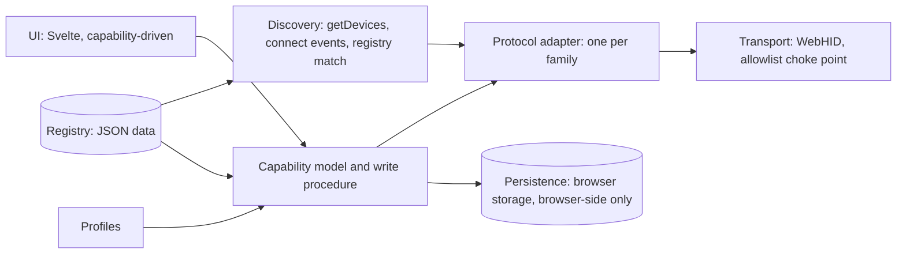

# UDB specification (v1)

UDB is a browser-based control center for gaming mice, keyboards and headsets.
It shows only the controls a device really supports, and it reports only
values the device reads back.

Decisions behind this spec are recorded in `docs/adr/`. Protocol facts are in
`docs/protocols/`. Research status is in `COMPATIBILITY.md`.

## Scope

**In v1:**
- Detecting devices that are allowed and previously granted.
- Showing the device's identity and connection.
- Per-feature controls generated from capability data.
- Read-back on every write.
- On-device profiles where the protocol has them; browser-stored profiles with
  import/export otherwise.
- Troubleshooting for each device.

**Not in v1:**
- A companion service. Features that need one are labelled "needs companion".
- Firmware, bootloader and DFU commands, in any phase, without separate
  approval.
- Pairing and factory reset (separate decisions).
- Runtime extensions.
- Telemetry.
- Non-Chromium browsers.

## Platform

Supported and tested: **Windows 11, Chrome and Edge.** Linux (hidraw via udev
rules) and macOS are documented but untested.

Confirmed constraints:
- WebHID needs a secure context, and `requestDevice()` needs a user gesture.
- `getDevices()` returns previously granted devices, so returning users skip
  the prompt.
- Chromium blocks the keyboard usage page, system-control and dock usages
  entirely. On Generic Desktop mouse, pointer, keyboard and keypad
  collections, it blocks input and output reports but **allows feature
  reports** (`IsAlwaysProtected` in
  `services/device/public/cpp/hid/hid_report_utils.cc`). Vendor pages
  (`0xFF00`+), Consumer and LampArray (`0x59`) are open.
- WebUSB cannot claim HID-class interfaces, and websites cannot install
  drivers.
- A wireless device is identified through its receiver. The receiver PID names
  the receiver; the device behind it is identified by a protocol query (for
  example, `compx` CID/MID).
- Vendor software that is running can hold an interface or fight over it.
- Chromium persists a HID permission only for devices with a USB serial
  number and product name (`HidChooserContext::CanStorePersistentEntry`).
  Without a serial (e.g. the Vibe75), the grant is keyed to the connection
  and must be given again after every replug.

## Architecture

| Layer | Owns | Never does |
|---|---|---|
| Discovery | Device enumeration, connect/disconnect, matching a HID device to a registry entry, permission prompts | Sending reports |
| Transport | Opening devices, sending and receiving reports, timeouts. **Enforces each adapter's command allowlist and the registry's collection denylist on every outgoing report**, and refuses report IDs the descriptor does not declare unless the registry names them (`undeclaredFeatureReports`, for Razer). | Protocol knowledge |
| Protocol adapter | Encode/decode for one protocol family, framing, checksums, the list of allowed commands | UI concerns; choosing values |
| Capability model | The features a device has, their ranges, where each setting lives, and the **write procedure** | Bytes |
| Persistence | UI preferences and browser-stored profiles | Storing device reports |
| Profiles | On-device profile switching (through the adapter) or browser profile apply/import/export | Bypassing the write procedure |
| UI | Rendering capability data and truth states | Importing adapter or transport code |

Adapter code and registry data have no dependency on the UI, so contributors
adding a device never touch Svelte.

## Capability model

Each feature on a device has:
- `id` (e.g. `dpi.stages`, `polling-rate`, `sidetone`)
- `kind`: `range` | `enum` | `bool` | `color` | `keymap` | `macro` | `profile`
- the constraints (min/max/step or the allowed values)
- `location`: `device` (stored on the hardware), `browser` (stored in this
  browser), or `companion` (needs the PC; shown as unavailable)
- `status`, with evidence (see Registry)

The UI renders only features with `location: device` or `browser` whose status
is `read-verified`, `write-verified` or `experimental`. `experimental`
controls carry an "unverified" label and need an extra confirmation before the
first write.

## Write procedure (one implementation, in the capability layer)

1. Validate the value against the feature's constraints. Reject before
   anything is sent.
2. Send through the adapter. The transport rejects any report not on the
   allowlist.
3. Read back through the adapter.
4. Compare and report. If they match, the value is confirmed. If they don't,
   write the previous value back, read it back again, and show the user
   requested vs. actual vs. restored.

If a feature can't be read back, it can't reach `write-verified`. Its UI says
"sent; device does not report back".

UI truth states for every control: `idle` → `sending` → `confirmed` |
`mismatch-restored` | `mismatch-unrestored` | `failed`. The display always
shows the last value the device returned, never the requested value.

## Registry

JSON files at `registry/devices/<vendor>/<model>.json`, validated against
`registry/schema/device.schema.json`. Each entry records:
- the VID/PIDs and, where needed, the in-protocol identity (e.g. CID/MID).
  A family whose model is only known after a protocol query can instead use
  a `byCollection` identity: it matches any device exposing the entry's
  collection, of any vendor (QMK/VIA) or of one vendor (Logitech HID++
  receivers). An entry with the device's own VID/PID always wins.
- the connection type
- the protocol family
- the collections UDB uses, and **denied collections** (firmware, DFU)
- platform requirements and known limitations
- protocol references
- features, each with a status and evidence

Status: `detected` | `read-verified` | `write-verified` | `experimental` |
`unsupported`.

Evidence on each status: `source`, `hardware` (model and firmware, or null),
`date`, `confidence` (`low` | `medium` | `high`). Only `read-verified` and
`write-verified` require non-null `hardware`. Simulator and replay results can
never produce them.

The support matrix is generated from the registry (Phase 2) and is never
edited by hand.

## Security and privacy

See `THREAT_MODEL.md`. In short:
- request only the device the user picks
- no network calls at runtime other than loading the app itself
- strict CSP
- every device response is untrusted (lengths and bounds checked before
  parsing)
- nothing is uploaded

## Profiles

**Browser profiles** (v2, Phase 8: `src/lib/profiles.ts`,
`src/lib/profile-map.ts`, `src/ui/ProfileBar.svelte`,
`src/ui/ProfileLibrary.svelte`) are **Mouse** or **Keyboard** profiles that
apply to any device of that category whose panel reads its settings back one
by one: `compx`, `corsair-nxp`, `logitech-hidpp`, `razer` (mice) and `qmk-via`
(keyboards).
- A Mouse profile holds DPI stages (1 to 8), the active stage, the polling
  rate and a colour. A Keyboard profile holds a colour, a brightness (percent)
  and an effect tagged with its protocol family. Every field is optional; at
  least one is set.
- It is saved from what the device returned ("Save current settings") or made
  and edited in the library (Home, Profiles) without a device. UDB never saves
  a value it only requested from a device.
- It lives in this browser's `localStorage` (label: Browser). Nothing is sent
  anywhere.
- Applying one, inside a device and behind the same "allow unverified writes"
  gate, plans the panel's row writes (`profile-map.ts`) and writes each through
  the panel's write procedure, in the panel's row order, one at a time. Each
  value is read back; the result per setting (confirmed, mismatch, failed, not
  written with the device's reason, already set, unreadable) is shown, and so
  is everything the device couldn't take: extra or missing DPI stages, a
  one-DPI mouse getting the active stage, a rate the mouse refuses (its own
  range check), a colour on a mouse (no mouse adapter writes lighting), an
  effect from another protocol family.
- Export and import use a JSON file: `{ "udbProfile": 2, "name", "category":
  "mouse" | "keyboard", "mouse" | "keyboard": { … } }`. An import is untrusted
  input: size, shape, name and every field are checked against fixed bounds,
  unknown fields are dropped, and the values still go through each setting's
  range check when applied.
- v1 profiles (one device's own rows) are converted on first load through
  their registry entry's mapping; the v1 storage key is left untouched. A v1
  profile no mapping covers (a headset's sidetone) is kept as it was, listed
  under "Kept from an older version", exportable in v1 format, never applied.
  v1 files can still be imported.

**On-device profiles.** No adapter implements profile switching yet: the
stored-profile and onboard-mode commands of Corsair and Logitech are on the
allowlists' deny side (THREAT_MODEL T2), and Glorious and ROCCAT have no
adapter. The first candidate is the ROCCAT Kone (its current profile reads
back; `docs/protocols/roccat.md`).

## Keymap editing

QMK/VIA keyboards only (`src/ui/ViaKeymap.svelte`; protocol in
`docs/protocols/qmk-via.md`). Experimental, with no hardware evidence yet.
- The key layout comes from a VIA definition JSON the user loads. It is
  untrusted input (size, shape, every number checked) and must name this
  keyboard's VID/PID. Its matrix size bounds the commands UDB will send; the
  layer count comes from the keyboard.
- Layout options are chosen by the user, since UDB sends no command that reads
  them.
- A key is read from the keyboard, never from the file. Writing is gated by its
  own checkbox, changes one key at a time, and is read back like any setting.
- Only basic keys (HID usages up to `FF`) can be assigned. Layer, macro and
  quantum keycodes (which include bootloader and EEPROM-clear keys) are shown
  as numbers and can only be written back to a key that the keyboard itself
  returned for that position, for a restore.
- A change is stored in the keyboard's EEPROM at once. "Restore original" puts
  back what UDB first read at that key in this session.
- Macros are not built: the VIA macro commands stay refused.

## Error handling

| Situation | Behaviour |
|---|---|
| WebHID unavailable | Explain which browsers are supported. No dead controls. |
| Permission denied or chooser cancelled | Explain why the permission is needed, and offer to retry. |
| Device not in the registry | Show it as "unsupported": identity only, link to the contribution guide. |
| Interface busy (`open()` fails) | Name the likely vendor app from the registry and say how to close it. |
| Disconnect mid-write | Mark the write `failed`. On reconnect, re-read state; never assume. |
| Device asleep/offline (wireless) | Show it as offline. Allow no writes until the adapter reports it online. |
