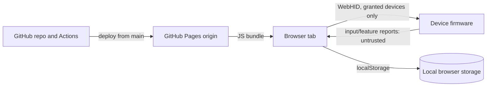

# UDB threat model (v1, browser-only)

Scope: the static web app on GitHub Pages at `udb.lorenzmalabanan.com`, the registry, and the protocol
adapters. Not in scope: malware on the user's PC, physical attackers, and
browser vulnerabilities themselves. Last reviewed 2026-10-18 (Phase 6; see
`docs/security-review.md`).

## Assets

1. **Device integrity.** A device must never be bricked, have its identity
   rewritten (VID/PID, descriptors, CID/MID), or be put into a firmware or
   factory mode.
2. **User data.** Macros (which are keystrokes), profiles, device serials and
   addresses.
3. **Truthfulness.** UDB never claims a setting was applied, or a device
   supported, without evidence.
4. **Grants.** The HID permissions the user gave this origin.

## Trust boundaries

## Threats and mitigations

| # | Threat | Impact | Mitigation | Residual risk |
|---|---|---|---|---|
| T1 | **Compromised deploy** (stolen GitHub account, malicious dependency, tampered Action) ships JS that sends arbitrary reports to granted devices | Bricked devices, identity rewrite | Deploy only from `main` via reviewed PRs; **enable branch protection on `main`** (currently off); 2FA; pin Actions by commit SHA; few dependencies with a committed lockfile and `npm ci`; strict CSP | **High.** Malicious code can bypass UDB's own allowlist; the allowlist limits *bugs*, not a hostile bundle. Users can self-host a reviewed tag. |
| T2 | **Malicious or careless adapter PR** adds a firmware, DFU or identity command | Same as T1 | Protocol docs classify every command; changes to an allowlist need cited evidence; permanently denied commands (e.g. `compx` 11, 12, 13, 17, 240; `qmk-via` 0B bootloader jump, 0A EEPROM reset, 06 keymap reset; `logitech-hidpp` DFU 0x00C2/0x00D0, reset 0x1802, host change 0x1814, onboard-mode switches, HID++ 1.0 registers; `razer` serial read, device mode, stage-table, lift-off, button and lighting classes; `corsair-nxp` polling, stage-mask, stored-profile and profile-name writes). The transport only sends a report the descriptor does not declare when the registry names it for that collection (Razer's control report). HID++ feature indices come from the device's own feature table, so the allowlist trusts that mapping are listed in the protocol doc and tested to be absent (Phase 2) | Reviewer error |
| T3 | **Hostile or buggy device response** (wrong length, out-of-range values) | Parser crash, wrong UI state, false "confirmed" | Every response is untrusted: check the report ID, length and bounds before parsing; complement/checksum checks where the protocol has them; decoders tested against captured fixtures | Low |
| T4 | **Bad write by UDB** (wrong encoding, out-of-range value) | Device misbehaves until reset | Validate ranges from the registry before sending; read back after every write; restore and report on mismatch; experimental features need an extra confirmation | Medium for `experimental` features, by design |
| T5 | **Firmware, bootloader, DFU, pairing or factory reset** | Brick, unpaired device | Not implemented. Registry denylist of collections (G14 `FF82:00CF`); adapter allowlists exclude them; firmware needs separate approval from the owner, per the brief | Low |
| T6 | **Privacy leak** of macros, serials, device lists | Keystroke patterns, fingerprinting | No telemetry; `connect-src 'self'`; data stays in this browser's storage (localStorage); export only on explicit user action; device dumps reach the project only when the user files them | Low |
| T7 | **Over-broad permission** | Access to unrelated devices | `requestDevice` filters only by registry-matched VID/PID and usage page, or, for a family identified by protocol, by its own collection: `FF60:0061` for QMK/VIA, the HID++ collections of VID `046D` for Logitech, and the standard LampArray collection `0059:0001`. Such a device gets only the protocol's identification query (VIA `01`) until it answers as that protocol. The prompt explains why each device is requested. "My device isn't listed" requests with no filter, so any HID device can be granted; a device with no registry-matched adapter has no allowlist, so UDB sends it nothing and only shows its descriptor | Low |
| T8 | **Injection through device strings** (`productName`, LCD text) | XSS in the UDB origin, which would expose the grants | Svelte escapes text by default; `{@html}` is banned (lint rule in Phase 2); CSP `script-src 'self'` | Low |
| T9 | **Interface conflict** with vendor software | Interleaved commands corrupting settings | Detect `open()` failure or unexpected responses; name the conflicting app from the registry; never retry writes blindly | Medium |
| T10 | **Embedding / clickjacking** | Tricking a user into a grant | WebHID in a cross-origin iframe needs a `hid` permissions-policy grant that UDB never gives. GitHub Pages can't send `frame-ancestors` (a `<meta>` CSP can't set it). | Low |
| T11 | **Malicious registry data** (misleading `write-verified` claims) | Users trust an unverified control | The schema requires hardware evidence for `read-verified`/`write-verified` and read-back for `write-verified` (`scripts/check-registry.sh`); reviewers check the evidence | Reviewer error |
| T12 | **Cached stale or tampered code** (the service worker keeps a bundle after the deploy is fixed or rolled back) | A bad bundle keeps running | Navigations go to the network first, so a reload gets the current page; no `skipWaiting`, so a new worker never takes over mid-session; the cache name changes every commit and old caches are deleted; users can clear site data or uninstall (ADR 9) | Low; an offline user runs the last version they loaded |
| T13 | **Hostile or careless profile file** (imported by the user) | Extreme values written to a device; a parser or storage bug | The file is size-capped and parsed as JSON only. v2: category, name and every field are checked against fixed bounds (1–8 DPI stages of 1–100,000, a listed polling rate, `#rrggbb`, brightness 0–100, an effect family name and 0–255), and unknown fields are dropped; v1 files are checked as before, then converted. Applying plans writes only to rows the connected panel already has, and each goes through that setting's own range check and the write procedure with read-back, one at a time; nothing is executed | Low |
| T14 | **Hostile or careless VIA definition file** (loaded by the user) or a keymap write that bricks input | A keyboard left without a usable key, or with a reset or bootloader key assigned; a parser bug | The file is size-capped and parsed as JSON only; matrix size, key count, coordinates and layout options are bounded; it must name the connected VID/PID; the matrix bounds every keymap command in the allowlist, and the layer count comes from the keyboard. Only basic keys (`<= FF`) can be assigned; other keycodes can be written only if the keyboard returned that exact value for that key. Writes are read back and restored on mismatch, one key at a time, behind their own gate. Any key can be set back with "Restore original" or with another keyboard's VIA | Medium for `experimental` keymap writes, by design |
| T15 | **Subdomain takeover** (the `udb` DNS record keeps pointing at GitHub Pages after the site or its domain setting is removed, so someone else's Pages site claims it) | A lookalike UDB on the real domain, holding new grants | The owner verifies `lorenzmalabanan.com` on their GitHub account, so no other account can use it; no wildcard DNS record; remove the `CNAME` record before removing the site (`docs/deploy.md`, ADR 12) | Low once verified |

## Decisions this threat model depends on

- ADR 1 (browser-only): no daemon means no localhost attack surface.
- ADR 5 (no telemetry, supply chain).
- ADR 6 (deploy from `main` only), amended by ADR 12 (custom domain, verified).
- ADR 9 (service worker: network-first navigation, no early takeover).

## Actions for the owner

1. Turn on branch protection for `main`: require a PR and block force pushes.
   Phase 0 needed one force push to remove commit attribution; that's done
   now.
2. Make sure 2FA is on for the GitHub account that owns `E1yWrites/udb`.
3. Verify `lorenzmalabanan.com` on GitHub before setting the custom domain
   (T15, `docs/deploy.md`).
